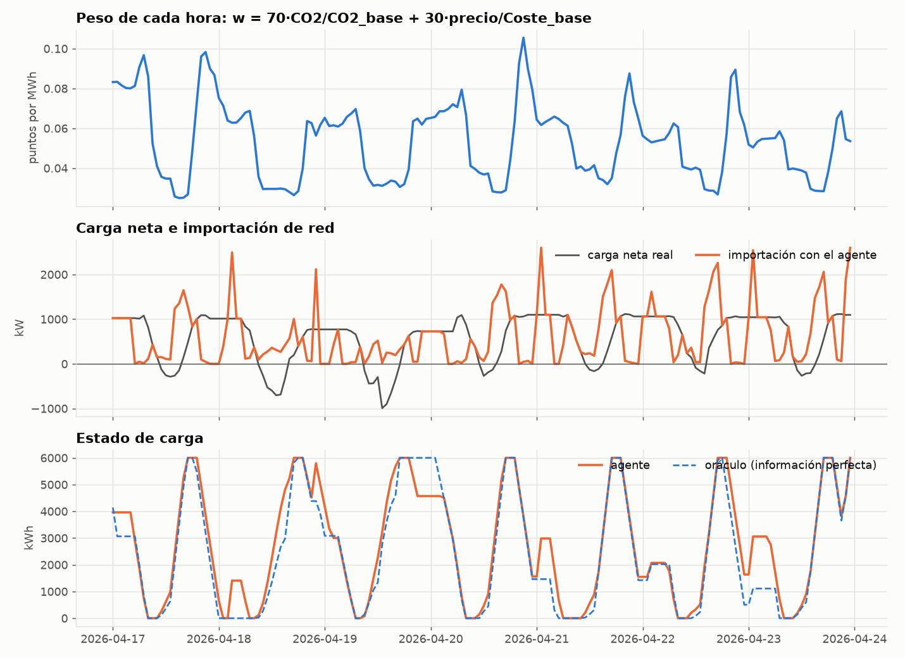

# Datathon 2026 · Repte UPC Sostenible — La batería del campus

**Equipo Manguets** · Jordi Urós · Gabriel Prado · Marc Pérez

Un `BatteryAgent` que decide cada hora cuánto cargar o descargar la batería del campus de la UPC para
reducir a la vez las **emisiones de CO₂ (70 %)** y la **factura eléctrica (30 %)**, sin cometer nunca
una infracción física. Combina **previsión** (bosques LightGBM exportados a numpy) con **control
predictivo** (programación lineal cada hora, MPC).

| Entrega final | Modo | Zip | Resultado |
|---|---|---|---|
| Control predictivo con LP de 24 h | Estándar (2 MWh, precio/CO₂ a 24 h) | [`entregas/estandar_submission_20261114_161446.zip`](entregas/) | **6,44** en el leaderboard público, igual que el oráculo |
| Previsión multihorizonte + LP con escenarios | Difícil (6 MWh, precio/CO₂ a solo 3 h) | [`entregas/dificil_submission_final.zip`](entregas/) | **20,39** en validación cruzada continua (oráculo 21,45) |

---

## 1. El reto en 30 segundos

- Cada hora el agente recibe `obs` (hora, SOC, precio y CO₂ conocidos, consumo y solar de la hora anterior)
  y devuelve una potencia en kW: `> 0` carga y `< 0` descarga.
- **Score** = `0,70·ΔCO₂ % + 0,30·ΔCoste %` frente al campus sin batería, menos una penalización por infracción.
- Test oculto: la última semana de cada mes (≈2.016 h), **una sola instancia del agente** y el SOC no se
  reinicia entre semanas. Límites: 60 s y 25 MB; solo numpy/pandas/scipy/sklearn/lightgbm…, sin `os`, `sys` ni red.

| | Modo Estándar | Modo Difícil |
|---|---|---|
| Batería | 2.000 kWh · ±500 kW | 6.000 kWh · ±1.500 kW |
| Solar | ×1 | ×12 (≈1,7 MW de pico → excedentes a mediodía) |
| Precio y CO₂ conocidos | próximas 24 h | **solo la hora actual + 2** |
| Qué decide el score | cuándo cargar y cuándo descargar | **predecir** mercado y carga neta |

Enunciado completo: [`docs/ENUNCIAT.md`](docs/ENUNCIAT.md) · resumen de reglas y FAQ:
[`docs/RETO_Y_MODO_DIFICIL.md`](docs/RETO_Y_MODO_DIFICIL.md) · variables: [`docs/GUIA_VARIABLES.md`](docs/GUIA_VARIABLES.md).

## 2. La idea clave: el score es lineal

El consumo neto del campus supera los 500 kW en el 99,5 % de las horas, así que la batería casi nunca
"sobra". Entonces cada kWh descargado en la hora *t* vale siempre lo mismo:

```
w_t = 70 · co2_t / CO2_base  +  30 · precio_t / Coste_base      (puntos por kWh)
```

Maximizar el score equivale a **mover energía de las horas baratas en w a las caras**, respetando la física
(η = √0,9 por sentido, capacidad y potencia). Es un problema de programación lineal que resolvemos
**cada hora** con el horizonte conocido, y del que solo se ejecuta la primera hora (horizonte deslizante).

Dos hallazgos que cambian la estrategia frente a la plantilla oficial:
- El CO₂ es **mínimo a mediodía** (≈0,05 kg/kWh) y **máximo de noche** (≈0,10). La heurística de
  referencia carga de noche, justo la peor hora para el 70 % del score.
- La plantilla oficial tiene un bug de redondeo de η (0,9487 en vez de √0,9) que genera 9 infracciones
  y deja el score en 0. Nuestro agente recorta siempre a los límites físicos: **0 infracciones** en todos
  los experimentos.


*Una semana de abril en Modo Difícil: arriba el peso de cada hora; abajo, el SOC del agente (naranja)
sigue al del oráculo con información perfecta (azul discontinuo).*

## 3. Modo Estándar — en el óptimo

Con precio y CO₂ exactos a 24 h, el MPC con LP **iguala al oráculo** con información perfecta:

| | Validación | Año completo |
|---|---|---|
| Plantilla oficial | 0,00 (9 infracciones) | — |
| Plantilla con η corregida | 1,38 | 1,27 |
| **Nuestro agente** | **6,10** | **5,67** |
| Oráculo (LP con todo el futuro) | 6,12 | 5,67 |

La diferencia restante en validación es un corte de sensores el 17–18 de junio, imposible de prever.
Para comprobar que no queda margen le dimos al mismo MPC el futuro **real** ([`scripts/headroom.py`](scripts/headroom.py)):
conocer precio y CO₂ a 48–72 h aporta **+0,000** y conocer la carga neta perfecta solo ayuda durante
ese corte. Por eso no tiene sentido añadir modelos de previsión en este modo.

Robustez ([`scripts/stress_test.py`](scripts/stress_test.py)): el agente aguanta ruido en las previsiones,
NaN, claves que faltan, tipos inesperados (arrays, Series) y observaciones malformadas sin perder score,
con un presupuesto de tiempo (≈6 s para 2.016 h, límite 60 s).

## 4. Modo Difícil — predecir para decidir

Con solo 3 h de mercado y la solar ×12, el LP necesita previsiones. El agente final
([`DataDificil/submission_v3/agent.py`](DataDificil/submission_v3/agent.py)) es un único fichero que:

1. **Prevé 24 h** de consumo, solar, precio y CO₂ con 10 bosques LightGBM especializados por horizonte
   (h0, h1–2, h3–23 para consumo y solar; h3–7 y h8–23 para mercado), más 2 que predicen el error σ̂
   de la carga neta. Las variables se calculan con
   **la misma función** en entrenamiento y en el agente, y un test comprueba que no leen el futuro.
2. **Evalúa los árboles con numpy**: los bosques se exportan a arrays (`bundle.npz`, 2 MB) porque el
   servidor no garantiza LightGBM. El entrenamiento comprueba que la predicción coincide con LightGBM.
3. **Resuelve un LP con 9 escenarios** de carga neta (previsión + σ̂·z, con σ̂ predicha por horizonte),
   bien calibrados fuera de muestra, para no descargar energía que se vertería a 0 €.
4. **Conserva la energía entre semanas** porque el SOC continúa, y planifica el arranque de la semana
   siguiente al acabar cada bloque.
5. **Safety clamp** físico, detección automática de modo (el mismo zip sirve para los dos) y un gobernador
   de tiempo con regla de reserva.

### Cómo validamos

Validación cruzada con **22 semanas de pseudo-test** (2 pliegues, modelos entrenados sin las semanas
evaluadas) y dos protocolos: **P1** semanas separadas con SOC al 50 %, y **P2** semanas seguidas con SOC
continuo, que es el del servidor. Score agregado con base común, como en la web.

| Modo Difícil (22 semanas) | P1 | **P2 (servidor)** |
|---|---|---|
| Agente v1 del pipeline | 21,71 | 20,34 |
| + variables de tendencia del mercado | 21,74 | 20,36 |
| **+ pérdida Huber para precio y CO₂ (entrega final)** | **21,77** | **20,39** |
| Oráculo con información perfecta | 22,84 | 21,45 |

Inyectando la verdad en cada previsión medimos dónde está el hueco restante: el CO₂ futuro vale +0,57,
la carga neta a 24 h +0,45 y el precio +0,12. El controlador ya es óptimo: con todo el futuro real el
agente iguala al oráculo, así que el hueco que queda es solo de previsión.

Más detalle: [`DataDificil/reports/RESULTADOS.md`](DataDificil/reports/RESULTADOS.md) (ablaciones y error
de previsión), [`DataDificil/BLUEPRINT.md`](DataDificil/BLUEPRINT.md) (diseño) y el notebook
[`DataDificil/notebooks/analisis_jurado.ipynb`](DataDificil/notebooks/analisis_jurado.ipynb).

## 5. Side challenge RawTree

Los agentes registran cada decisión (SOC, potencia, precio, CO₂, tiempo del LP…) en RawTree para poder
auditar su propio historial con SQL. Funciona en modo offline si no hay clave. Ver
[`docs/side_challenge/`](docs/side_challenge/README.md).

## 6. Estructura del repositorio

```
.
├── entregas/                 ← los dos zips finales (Estándar y Difícil)
├── submission/               Modo Estándar: agent.py (MPC-LP) + logger RawTree
├── src/datathon/, scripts/   Modo Estándar: simulador, oráculo, estrés, headroom, empaquetado
├── DataDificil/              Modo Difícil: pipeline completo
│   ├── submission_v3/        ← agente final (agent.py + bundle.npz + params.json)
│   ├── src/dd/               datos, simulador, CV, variables, entrenamiento, exportación a numpy
│   ├── scripts/              00_build_data → 01_oracle → 02_train → 03_cv → 04_package_verify → 05_figures
│   ├── tests/                paridad con el entorno oficial y causalidad de las variables
│   ├── reports/              resultados de CV (cv/*.json), figuras y RESULTADOS.md
│   └── experimentos/         variantes descartadas (W directa, pesos de CO₂…)
├── submission_dificil/       primera versión del Modo Difícil (superada)
├── notebooks/                exploración inicial de datos
├── docs/                     enunciado, reglas, guía de variables, side challenge
├── starter_kit/              kit oficial sin modificar
└── archivo/                  versiones anteriores y entregas de prueba del equipo
```

## 7. Reproducir

```bash
python -m venv .venv && source .venv/bin/activate
pip install -r requirements.txt
# Copiar los CSV oficiales de data/train a data/raw/train/

# Modo Estándar
python scripts/evaluate.py --oracle        # agente vs oráculo en validación
python scripts/stress_test.py              # tabla de robustez
python scripts/make_submission.py          # zip + validador oficial

# Modo Difícil (desde DataDificil/)
cd DataDificil
python scripts/00_build_data.py --rebuild  # tablas horarias
python scripts/01_oracle.py                # techo con información perfecta
DD_AGENT=submission_v3/agent.py DD_MKT_OBJ='{"co2":{"objective":"huber","alpha":0.01},"price":{"objective":"huber","alpha":0.02}}' \
  python scripts/02_train.py --fold A B full --tag hubcp --out submission_v3   # pliegues de CV + modelo final
python scripts/03_cv.py --agent submission_v3/agent.py --mode hard --tag hubcp --name final  # P1 / P2
DD_SUB_DIR=submission_v3 DD_FOLD_TAG=hubcp python scripts/04_package_verify.py   # zip + verificación
```

`04_package_verify.py` empaqueta el zip, pasa el validador oficial, escanea los imports con AST, mide el
tiempo de una ejecución completa y lanza pruebas de estrés y de fuga de información.

Verificación del zip final del Modo Difícil: validador oficial **VÁLIDA**; ejecución continua de 2.009 h en
**29 s** (Difícil) y **17 s** (Estándar) con 0 infracciones; 11 escenarios de estrés (NaN, tipos raros,
claves ausentes, obs malformada, sin modelos…) sin ninguna infracción; y test de fuga: alterar el futuro
no cambia ninguna acción pasada.
